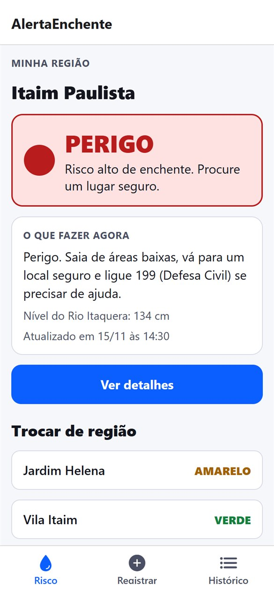
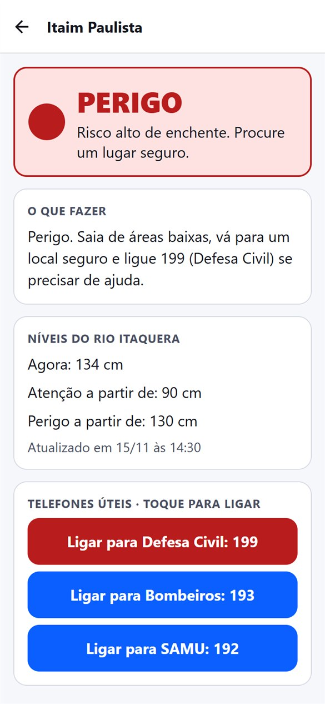
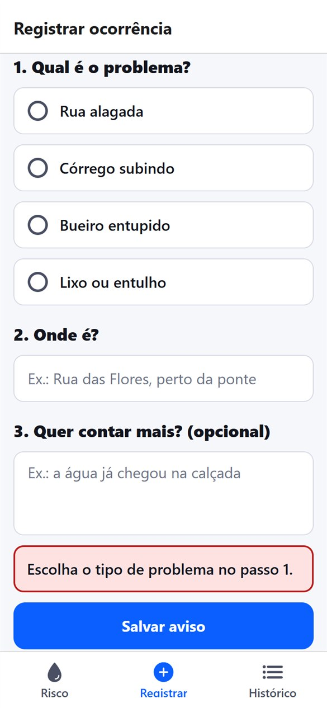
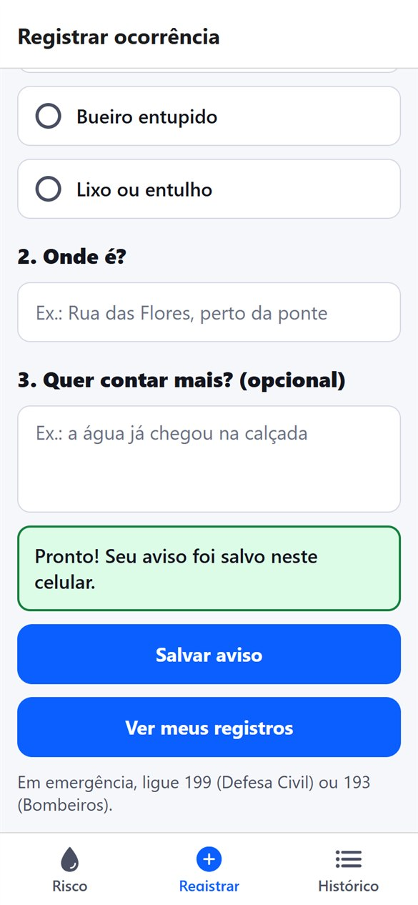
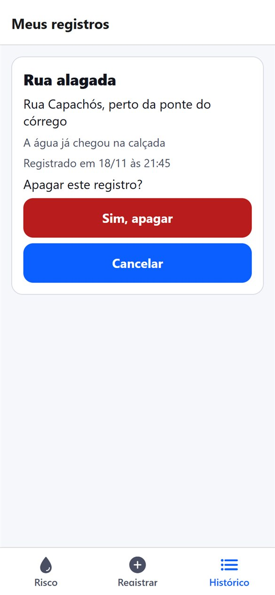

# AlertaEnchente · App Mobile (CitizenTech)

Entrega de **Mobile Development & IoT** · FIAP · Engenharia de Software (3º ano) · Global Solution 2026.2

App em **Expo (React Native + TypeScript + Expo Router)** que leva o AlertaEnchente ao celular do morador de área alagável.

## Equipe

| Integrante | RM |
|---|---|
| Arthur Silva | RM553320 |
| Eduardo Escudero | RM556527 |
| Leonardo Prado | RM556824 |
| Davi Vieira | RM556798 |
| Luca Monteiro | RM556906 |

**Nome do grupo:** AlertaEnchente

## Ficha da CitizenTech

| Campo | Preenchimento |
|---|---|
| Nome da CitizenTech | AlertaEnchente |
| Cidade e bairro | São Paulo, Jardim Helena (Zona Leste) |
| Cidadão beneficiado | Moradores e pequenos comerciantes de áreas alagáveis |
| Problema, em uma frase | Moradores de áreas alagáveis recebem os avisos de enchente tarde demais para proteger pessoas e bens. |
| Como funciona | O app mostra, com um farol verde, amarelo ou vermelho, o risco de enchente na região do morador, diz o que fazer em linguagem simples e permite registrar problemas (rua alagada, bueiro entupido, córrego subindo) que ficam salvos no celular. |
| O que cada parte faz | Mobile (este repositório): consulta e registro pelo celular. Cybersecurity: protege dados pessoais. Infraestrutura Linux: hospeda e monitora. Demais disciplinas: API, sensores e previsão de risco. |
| Indicador de impacto | Tempo entre o aviso e o morador ler a orientação; número de ocorrências registradas por região |
| ODS conectados | ODS 9, ODS 11 e ODS 13 |

## Jornada principal do cidadão

1. Abre o app e vê **na hora** o risco da sua região (farol + frase curta + o que fazer).
2. Se vir um problema, abre **Registrar**, escolhe o tipo, diz onde é e salva.
3. Em **Histórico** confere (e apaga, se quiser) o que já registrou.

## Telas

| Tela | Rota | O que faz |
|---|---|---|
| Risco | `app/(tabs)/index.tsx` | Farol da região escolhida, orientação, nível do córrego, troca de região, puxar para atualizar |
| Detalhes da região | `app/regiao/[id].tsx` | Cotas de atenção e perigo, orientação e **botões que ligam direto** para a Defesa Civil (199), os Bombeiros (193) e o SAMU (192) |
| Registrar | `app/(tabs)/registrar.tsx` | Formulário em 3 passos com validação, aviso de sucesso e atalho para o Histórico |
| Histórico | `app/(tabs)/historico.tsx` | Lista salva no SQLite, com confirmação antes de apagar e aviso se algo der errado |

Navegação com **Expo Router**: abas (Risco, Registrar, Histórico) e uma tela empilhada de detalhes.

## Consumo de dados (API ou mock)

`src/api.ts` busca `GET {EXPO_PUBLIC_API_URL}/regioes`. O app usa o mock `src/mock/regioes.json` e continua funcionando offline quando:

- a variável não existe;
- a rede falha;
- a API **demora mais de 6 segundos** (timeout com `AbortController`, para a tela nunca ficar carregando para sempre);
- a resposta **não tem o formato esperado** (a lista de regiões é validada antes de ser usada).

A tela sempre avisa de onde vieram os dados. O formato esperado da API é o mesmo do mock.

Regra do farol (`src/risco.ts`): **verde** abaixo da cota de atenção, **amarelo** entre atenção e perigo, **vermelho** acima da cota de perigo.

## Banco de dados (SQLite local)

`src/db.ts` usa `expo-sqlite` com duas tabelas:

- `ocorrencias(id, tipo, local, descricao, criado_em)`: CRUD de registros do cidadão (criar, listar, apagar);
- `preferencias(chave, valor)`: lembra a região escolhida, mesmo depois de fechar o app.

## Acessibilidade

- Fonte base de 18 px e títulos grandes; botões com no mínimo 56 px de altura.
- O estado do farol vai em **texto** (TRANQUILO, ATENÇÃO, PERIGO), não só em cor.
- Contraste alto (texto escuro sobre fundo claro) e `accessibilityLabel`, `accessibilityRole`, `accessibilityState` e `accessibilityHint` nos controles, para leitores de tela (TalkBack e VoiceOver).
- Mensagens de erro e de sucesso com `accessibilityLiveRegion`; erros também com `accessibilityRole="alert"`.
- O botão "Salvar aviso" fica sempre ativo: se faltar algo, o app **diz o que falta** ("Escolha o tipo de problema no passo 1"), em vez de só desabilitar o botão sem explicação.
- Telefones de emergência são botões grandes que abrem o discador, sem precisar decorar o número.
- Linguagem simples, sem termos técnicos, pensando em um cidadão de 60 anos.

## Como rodar

Pré-requisitos: **Node 20+** e o app **Expo Go** no celular (Android ou iPhone). O repositório já é o projeto completo: não precisa criar outro.

```bash
git clone https://github.com/duduescudero/alerta-enchente-mobile.git
cd alerta-enchente-mobile
npm install          # instala as dependências (inclui o expo-sqlite)
npx expo start       # abre o servidor e mostra o QR code
```

Leia o QR code com o Expo Go (Android) ou com a câmera (iPhone). Celular e computador devem estar na mesma rede Wi-Fi. Se a rede bloquear, use `npx expo start --tunnel`. Para ver no navegador, aperte `w` no terminal.

**Sem configurar nada, o app já funciona** com os dados de demonstração (`src/mock/regioes.json`).

### Usar uma API real (opcional)

Copie `.env.example` para `.env` e coloque o endereço da API:

```bash
EXPO_PUBLIC_API_URL=http://192.168.0.10:8080
```

Use o IP do computador na rede Wi-Fi: o celular não enxerga `localhost`. O Expo lê o `.env` sozinho, no Windows, no Mac e no Linux. Depois de mudar o `.env`, reinicie com `npx expo start -c`.

### Verificar os tipos

```bash
npm run typecheck
```

## Verificação

- `npm run typecheck`: sem erros de TypeScript (modo `strict`).
- `npx expo export --platform web`: todas as telas compilam, inclusive o SQLite no navegador (WebAssembly).
- Jornada completa testada no app rodando:
  - trocar a região e ela continuar escolhida depois de recarregar (preferência no SQLite);
  - abrir os detalhes, com os 3 botões de ligar;
  - tentar salvar sem preencher e ver o que falta;
  - salvar um aviso e ver a confirmação;
  - ver o aviso no Histórico, inclusive depois de recarregar, e a confirmação antes de apagar.
- API fora do ar: o app cai nos dados de demonstração e avisa na tela, sem travar no carregamento.

## Prints das telas

| Risco | Detalhes e telefones | Registrar: o que falta | Registrar: salvo | Histórico |
|---|---|---|---|---|
|  |  |  |  |  |

## Estrutura

```
app/                  rotas (Expo Router)
  _layout.tsx         pilha principal
  (tabs)/             abas: index, registrar, historico
  regiao/[id].tsx     detalhes da região
src/
  api.ts              API com fallback para mock
  db.ts               SQLite (ocorrências e preferências)
  risco.ts            regra do farol e formatação
  components/         Farol, Botao
  mock/regioes.json   dados de demonstração
```

## Uso de IA

O registro de como a equipe usou IA no desenvolvimento e na revisão está em [`prompts.md`](prompts.md).

## Vídeo

Demonstração completa do app (1min58s), mostrando cada critério da rubrica: https://youtu.be/yKTf51cVZH4
